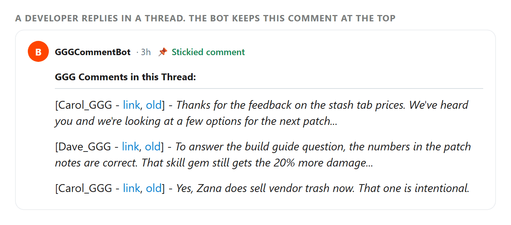

# GGGCommentBot

When a Path of Exile developer comments in a thread on r/pathofexile or r/PathOfExile2, this bot keeps a stickied comment at the top of that thread with a link to each of their replies. Readers can jump to what the developers said without scrolling the whole thread.

Redrawn to look like Reddit.

Each line has the developer's name, links to the reply on new and old Reddit, and its first 30 words. When the comment fills up, the bot carries on in a reply to itself.

It started as kjennett's GGGCommentBot and has been modified by multiplicitypoe.

## Running it

You need Python 3 and a Reddit account that moderates the subreddit, since the bot stickies its own comment.

1. `pip install praw`
2. Create a script app at https://www.reddit.com/prefs/apps and note its client id and secret. The bot account has to be listed as a developer on the app.
3. Copy `.env.example` to `.env` and fill in the bot account's username and password and the app's client id and secret.
4. Run `python3 GGGRedditBot.py`.

The bot checks the subreddit's newest comments every 15 seconds. Every 5 minutes it also scans each developer's recent comments, in case one was missed. What it has already handled is saved in `.pickle` files next to the script.

To cover r/PathOfExile2, run a second copy from its own folder with `SUBREDDIT_NAME=pathofexile2` in `.env`. Each copy keeps its own state.

## Changing it

The list of developer accounts (`ggg_emps`), the snippet length, and the comment format are variables at the top of `GGGRedditBot.py`.
